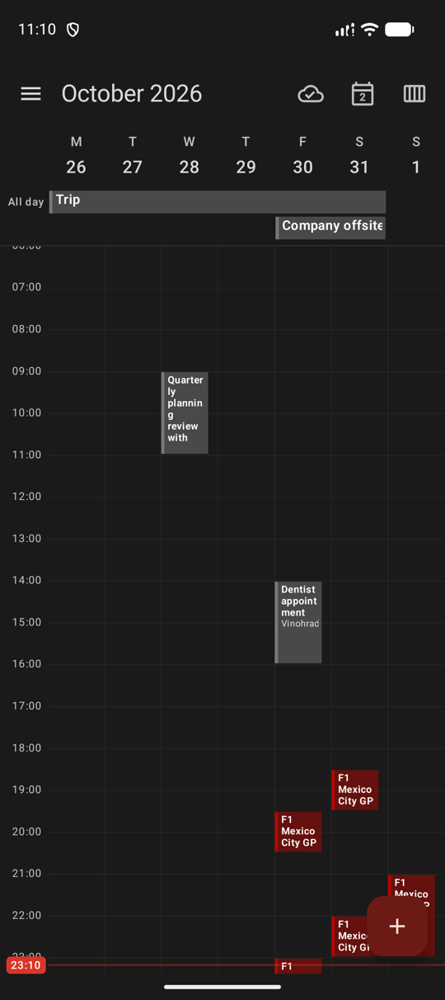
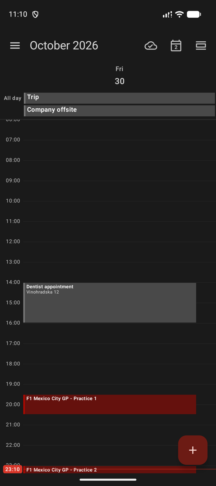
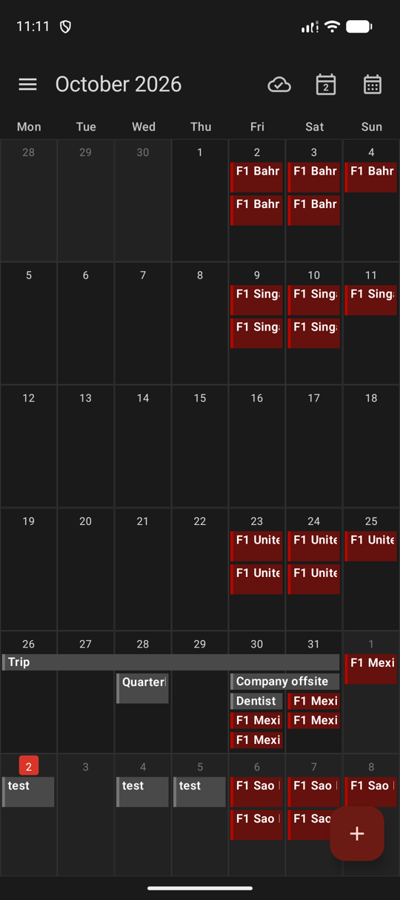
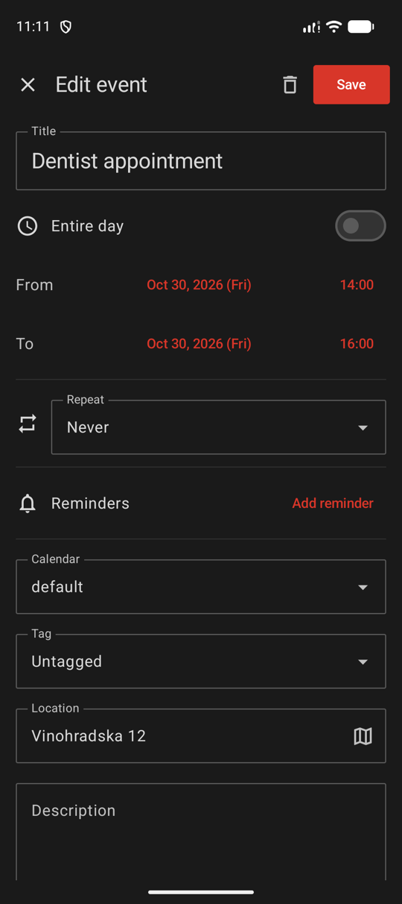
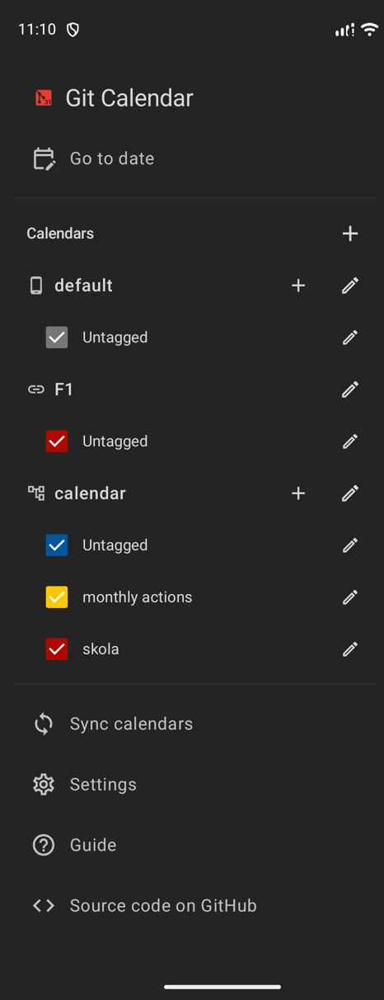

# Git Calendar for Android

A native Android client for [Git Calendar](https://github.com/git-calendar): calendars stored in Git repositories. Built with Kotlin and Jetpack Compose (Material 3).

> [!NOTE]
> This app is 100% generated by AI, use with caution

| Week | Day | Month | Event | Calendars |
|:---:|:---:|:---:|:---:|:---:|
|  |  |  |  |  |

## Features

- Git calendars: create, clone, sync with a remote, optional encryption
- iCal feed subscriptions and `.ics` import, ZIP / ICS export, ZIP restore
- Tags, repeating events, reminders and background sync
- _other standart calendar features..._

## Core

The calendar logic is the shared Go core of Git Calendar, bound to Android with gomobile. The app binds the `pkg/api` package of [git-calendar/core](https://github.com/git-calendar/core).

## Build

```bash
git clone https://github.com/git-calendar/android-client.git
cd android-client
make fetch-core
./gradlew installDebug
```

`make fetch-core` downloads `core.aar` of the core version pinned in the `Makefile` into `app/libs`. `make fetch-core-latest` downloads the latest release instead.

Requirements: Android Studio (Android SDK).

Unit tests: `./gradlew test`. The app needs Android 12 (API 31) or newer.
